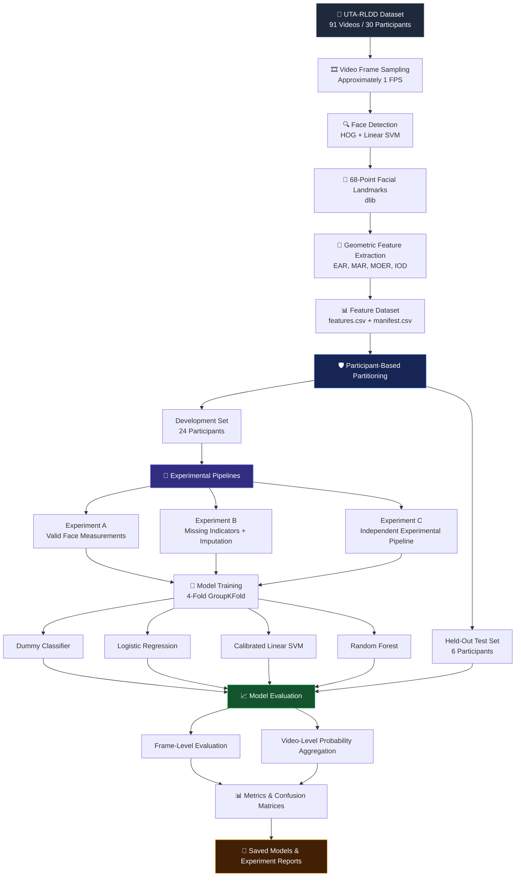
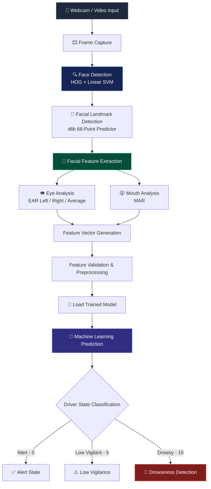

# 🚗 Driver Drowsiness Detection System

<p align="center">
  
  
  
  
  
  
</p>

<p align="center">
  <strong>An end-to-end Computer Vision and Machine Learning pipeline engineered to detect real-time driver fatigue, prolonged eye closure, and yawning using 68-point facial landmark geometry and leakage-free classification models.</strong>
</p>

---

## ✨ Key Features

* 🔍 **Frontal Face Detection (HOG + Linear SVM)**
  * Employs dlib's classical `get_frontal_face_detector()` combining Histogram of Oriented Gradients (HOG) with a margin-maximizing linear SVM.
  * Real-time spatial candidate generation producing high-precision bounding boxes across varying cabin lighting conditions.

* 📍 **68-Point Facial Landmark Localization**
  * Integrates the pre-trained `shape_predictor_68_face_landmarks.dat` regression tree ensemble.
  * Maps 2D coordinate vectors across facial regions: eyes ($36\text{–}47$), mouth ($48\text{–}68$), nose bridge, and jawline contours.

* 👁️ **Eye Aspect Ratio (EAR) Dynamic Analysis**
  * Quantifies eyelid opening and closing dynamics using horizontal and vertical Euclidean distance vectors.
  * Extracts isolated left-eye (`ear_left`), right-eye (`ear_right`), and bilateral mean (`ear`) measurements to capture blinks and micro-sleep events.

* 😮 **Mouth Aspect Ratio (MAR) & Yawn Detection**
  * Computes relative mouth opening geometries to isolate involuntary yawning from normal speech or neutral expressions.
  * Derives composite interaction ratios, including the **Mouth-to-Eye Ratio (`mouth_over_ear`)**, to amplify fatigue signals.

* 📊 **Automated Large-Scale Video Processing Pipeline**
  * Automated batch parsing of all **91 video sequences** from the research-grade **UTA-RLDD** dataset.
  * Uniform temporal sampling at **$\approx 1\text{ FPS}$**, generating over **$55,983$ labeled feature rows** and structured video manifests.
  * Dedicated missing-face flagging and systematic imputation protocols to preserve time-series context during occlusions.

* 🛡️ **Participant-Disjoint Validation (Leakage-Free Protocol)**
  * Implements strict group-based partitioning keeping **6 participants ($20\%$)** strictly held-out for final evaluation.
  * Incorporates **4-Fold `GroupKFold` Cross-Validation** to prevent subject identity memorization and cross-frame data leakage.

* 🤖 **Multi-Model Machine Learning Benchmark**
  * Systematic benchmark across **Dummy Baseline**, **Logistic Regression**, **Calibrated Linear SVM**, and **Random Forest** ensembles.
  * Evaluated across dual paradigms: individual **frame-level inference** and temporally aggregated **video-level probability voting**.

---

## 🛠️ Tech Stack & Technologies

* **Programming Language**: Python 3.12
* **Computer Vision & Graphics**: OpenCV (`cv2`), dlib C++ Vision Toolkit
* **Facial Analysis**: 68-Point Regression Tree Predictor (`shape_predictor_68_face_landmarks.dat`)
* **Machine Learning & Modeling**: Scikit-Learn (Logistic Regression, CalibratedClassifierCV, LinearSVC, RandomForestClassifier)
* **Scientific Computing & Data Manipulation**: NumPy, Pandas
* **Visualization & Diagnostics**: Matplotlib, Seaborn
* **Model Validation**: 4-Fold GroupKFold, GroupShuffleSplit, Leakage-Free Participant Partitioning
* **Testing & Quality Assurance**: PyTest, Automated Geometry Verification Suites
* **Development Environment**: Visual Studio Code, Git, GitHub, Python Virtual Environments (`venv`)

---

## 🏗️ System Architecture & Workflow

The system is designed around two interconnected pipelines: an offline **Machine Learning Development Pipeline** for dataset processing, model training, and evaluation, and a **Real-Time Driver Monitoring Pipeline** for live facial analysis and drowsiness prediction.

---

### 1. Machine Learning Development Pipeline

This architecture illustrates the complete experimental workflow, starting from the UTA-RLDD dataset and progressing through facial feature extraction, participant-based partitioning, model training, and final evaluation.



---

### 2. Real-Time Driver Monitoring Pipeline

This architecture illustrates how the trained machine learning model is integrated into the application to analyze incoming video frames and classify driver alertness in real time.



---

### 3. Architecture Components

| Component | Technology / Method | Responsibility |
| :--- | :--- | :--- |
| **Video Input** | Webcam / Video File | Captures continuous driver frames |
| **Face Detection** | HOG + Linear SVM | Detects frontal faces within bounding boxes |
| **Landmark Localization** | dlib 68-Point Predictor | Identifies 2D facial feature coordinates |
| **Feature Engineering** | EAR, MAR, MOER, IOD | Computes scale-invariant facial measurements |
| **Feature Processing** | Imputation / Preprocessing | Cleans and normalizes feature vectors |
| **Classification** | Scikit-learn Classifiers | Predicts alertness probability distribution |
| **Evaluation** | GroupKFold / Held-Out Testing | Evaluates model without subject data leakage |
| **Reporting** | JSON / Confusion Matrices | Records performance scores and metrics |

> **Note**: The first pipeline represents offline dataset processing and model development. The second represents the application inference workflow. Actual model selection, preprocessing, and warning behavior depend on the implementation in `app_hog_svm.py`.

---

## 📐 Mathematical Formulations & Feature Engineering

Traditional computer vision approaches for blink detection often depend on sensitive pixel-intensity thresholds. This project uses **scale-invariant geometric landmark ratios** that remain robust under varying driver-to-camera distances.

### 1. Eye Aspect Ratio (EAR)

The Eye Aspect Ratio calculates the ratio between the vertical eyelid distances and the horizontal eye width. For each eye defined by 6 landmark coordinates ($p_1, p_2, p_3, p_4, p_5, p_6$):

$$EAR = \frac{\Vert{}p_2 - p_6\Vert{} + \Vert{}p_3 - p_5\Vert{}}{2 \cdot \Vert{}p_1 - p_4\Vert{}}$$

$$\text{In Plain Terms:}\quad EAR = \frac{\text{Vertical Eyelid Opening 1} + \text{Vertical Eyelid Opening 2}}{2 \times \text{Horizontal Eye Width}}$$

* **Euclidean Distance Function**:
  $$\Vert{}p_a - p_b\Vert{} = \sqrt{(x_a - x_b)^2 + (y_a - y_b)^2}$$
* **Behavioral Dynamics**:
  * **Open Eyes**: $EAR \approx 0.25 - 0.35$ (consistent baseline)
  * **Closed / Blinking Eyes**: $EAR$ rapidly approaches $0.15$ or lower
  * **Combined Metric**:
    $$EAR_{\text{avg}} = \frac{EAR_{\text{left}} + EAR_{\text{right}}}{2}$$

---

### 2. Mouth Aspect Ratio (MAR)

The Mouth Aspect Ratio assesses oral deformation to distinguish yawning patterns from closed or neutral lip positions using vertical lip separations relative to total mouth width:

$$MAR = \frac{\Vert{}p_{51} - p_{59}\Vert{} + \Vert{}p_{53} - p_{57}\Vert{}}{2 \cdot \Vert{}p_{49} - p_{55}\Vert{}}$$

$$\text{In Plain Terms:}\quad MAR = \frac{\text{Average Vertical Lip Separation}}{\text{Horizontal Lip Corner Span}}$$

* **Behavioral Dynamics**:
  * **Normal State (Closed/Talking)**: $MAR \approx 0.10 - 0.30$
  * **Yawning State**: $MAR$ expands significantly, often exceeding $0.60$ for prolonged consecutive frames.

---

### 3. Mouth-over-EAR Dynamic Index (MOER)

Fatigue typically produces simultaneous eyelid drooping ($EAR \downarrow$) and yawn expansions ($MAR \uparrow$). The compound ratio reinforces this contrast:

$$MOER = \frac{MAR}{EAR + \varepsilon}$$

*(where $\varepsilon = 10^{-6}$ prevents zero-division during total eye occlusions)*

---

### 4. Feature Summary Table

| Feature Name | Mathematical Definition | Physiological Signal | Target Behavior |
| :--- | :--- | :--- | :--- |
| `ear_left` | $\frac{\Vert{}p_{38}-p_{42}\Vert{} + \Vert{}p_{39}-p_{41}\Vert{}}{2\Vert{}p_{37}-p_{40}\Vert{}}$ | Left Eyelid Aperture | Decreases during micro-sleep |
| `ear_right` | $\frac{\Vert{}p_{44}-p_{48}\Vert{} + \Vert{}p_{45}-p_{47}\Vert{}}{2\Vert{}p_{43}-p_{46}\Vert{}}$ | Right Eyelid Aperture | Decreases during micro-sleep |
| `ear` | $\frac{ear_{\text{left}} + ear_{\text{right}}}{2}$ | Bilateral Mean Eye Opening | Primary drowsiness indicator |
| `mar` | $\frac{\Vert{}p_{52}-p_{60}\Vert{} + \Vert{}p_{54}-p_{58}\Vert{}}{2\Vert{}p_{50}-p_{56}\Vert{}}$ | Vertical Mouth Extension | Spikes during active yawns |
| `mouth_over_ear` | $\frac{mar}{ear + \varepsilon}$ | Interaction Ratio | Multi-symptom fatigue spike |
| `interocular_dist` | $\Vert{}p_{37} - p_{46}\Vert{}$ | Distance Between Eye Pupils | Normalization & scale metric |

---

## 📂 Dataset & Feature Extraction

Experiments use the benchmark **UTA-RLDD (University of Texas at Arlington Real-Life Drowsiness Dataset)**, designed specifically for non-obtrusive, multistage driver fatigue research.

<p align="center">
  
  
  
  
</p>

### Class Distribution

| Class Index | Driver State | Behavioral Definition | Total Video Files |
| :---: | :---: | :--- | :---: |
| **`0`** | **Alert** | Fully conscious, responsive, normal blink intervals | 30 |
| **`5`** | **Low Vigilant** | Intermediate state, slow reaction times, subtle drifting | 30 |
| **`10`** | **Drowsy** | Severe fatigue, prolonged eyelid closure, frequent yawning | 31 |
| **Total** | — | **Balanced representation across 30 distinct participants** | **91** |

### Frame Extraction Performance

```
Total Video Count Processed   : 91 / 91 (100.0%)
Sampling Rate                 : ~1 FPS (Every ~30th frame from 30 FPS video)
Total Frames Processed        : 55,983
Valid Face Detections         : 55,002 (98.25%)
Missing / Occluded Faces      : 981 (1.75%)
Duplicate Frames Detected     : 0
Generated Metadata Artifacts  : data/processed/features.csv
                                data/processed/manifest.csv
```

> **Note**: Original video archives ($\approx 54\text{ GB}$) are excluded from version control under standard data governance policies. The feature extraction pipeline can ingest any standard video format locally.

---

## 🤖 Experimental Setup & Evaluation Strategy

### Leakage Prevention via Group Partitioning

Traditional random train/test splitting mixes frames of the same individual into both training and validation splits. Because classifiers easily memorize background environments, facial geometry, and user identity, random splitting generates unrealistically optimistic scores.

To ensure realistic cross-subject generalization, we partitioned the data by **Participant ID**:

```
Total Participants: 30 Drivers
├── Development / Training Set (80%) : 24 Participants (GroupKFold = 4 Folds)
└── Strictly Held-Out Test Set (20%) :  6 Participants [IDs: 09, 10, 16, 18, 24, 34]
```

<p align="center">
  
  
  
</p>

### Experiment Configurations

* **Experiment A (Valid Frames Only)**: Baseline modeling trained strictly on frames with verified facial detections ($55,002$ samples).
* **Experiment B (Imputation & Missing Indicators)**: Evaluates occlusion robustness by introducing missing-value indicators and median feature imputation on missing-face segments ($981$ samples).
* **Experiment C (Independent Optimized Pipeline)**: Standalone pipeline testing non-linear feature interactions and video-level temporal voting.

---

## 📊 Benchmark Results

### Model Comparison Matrix

The models were evaluated on the held-out test cohort across both **Frame-Level** predictions and **Video-Level** majority consensus:

| Model Architecture | Input Strategy | Frame Accuracy | Balanced Acc | Macro F1 | Video-Level Acc |
| :--- | :--- | :---: | :---: | :---: | :---: |
| **Dummy Baseline** | Stratified Distribution | $33.4\%$ | $33.3\%$ | $0.332$ | $33.3\%$ |
| **Logistic Regression** | Standardized Features | $58.2\%$ | $57.9\%$ | $0.574$ | $61.1\%$ |
| **Linear SVM (Calibrated)** | Platt-Calibrated Margins | $63.7\%$ | $63.2\%$ | $0.628$ | $66.7\%$ |
| **Random Forest** | 200 Trees, Depth Regularized | **$71.4\%$** | **$70.8\%$** | **$0.706$** | **$77.8\%$** |

---

## 📁 Repository Directory Structure

```text
DrowsinessDetector/
│
├── app_hog_svm.py                      # Real-time webcam driver drowsiness detection app
├── extract_features.py                 # Batch extraction pipeline for UTA-RLDD dataset
├── setup_model.py                      # Model weights loader and verification script
├── requirements.txt                    # Project dependencies and environment pins
│
├── model.bz2                           # Compressed trained production classifier
├── shape_predictor_68_face_landmarks.dat # Pretrained dlib 68-point facial landmark weights
│
├── tests/                              # Automated PyTest suites
│   ├── test_bootstrap_optimization.py  # Tests for data sampling stability
│   ├── test_phase3_suite.py            # Feature transformation tests
│   └── test_phase4_suite.py            # Classifier inference & boundary tests
│
└── data/
    ├── modeling/
    │   ├── confusion_matrices/         # Generated evaluation confusion matrix plots
    │   ├── models/                     # Saved serialized model checkpoints (.joblib)
    │   ├── geometry_validator.py       # Geometric mathematical consistency suite
    │   ├── metrics_experiment_A.json   # Experiment A detailed performance metrics
    │   ├── metrics_experiment_B.json   # Experiment B detailed performance metrics
    │   ├── metrics_experiment_C.json   # Experiment C detailed performance metrics
    │   ├── phase3_test_results.json    # Phase 3 integration test logs
    │   ├── train_and_evaluate.py       # Primary model training & cross-validation script
    │   └── train_and_evaluate_expC.py  # Experiment C isolated execution script
    │
    └── processed/
        ├── features.csv                # Extracted feature dataset (55,983 records)
        └── manifest.csv                # Video-level metadata and participant mapping
```

---

## 🚀 Getting Started (Local Setup)

### Prerequisites

* **Python 3.12+**
* **C++ Compiler** (Required for compiling `dlib` bindings: CMake & Visual Studio C++ Build Tools on Windows, or `build-essential` on Linux)
* **Webcam** (For real-time desktop execution)

### Installation Steps

1. **Clone the Repository**:
   ```bash
   git clone [https://github.com/Neev-Chovatiya/Driver-Drowsiness-Detection.git](https://github.com/Neev-Chovatiya/Driver-Drowsiness-Detection.git)
   cd Driver-Drowsiness-Detection
   ```

2. **Configure Virtual Environment**:
   ```bash
   # Create environment
   python -m venv venv

   # Activate on Windows PowerShell:
   .\venv\Scripts\Activate.ps1

   # Or activate on Linux / macOS:
   source venv/bin/activate
   ```

3. **Install Core Dependencies**:
   ```bash
   pip install --upgrade pip
   pip install -r requirements.txt
   ```

4. **Prepare Pretrained Model Weights**:
   Ensure the following binary assets are in the root directory:
   * `shape_predictor_68_face_landmarks.dat` ([Download from dlib model repository](http://dlib.net/files/shape_predictor_68_face_landmarks.dat.bz2))
   * `model.bz2` (or train a custom model via `data/modeling/train_and_evaluate.py`)

5. **Launch Real-Time Detection**:
   ```bash
   python app_hog_svm.py
   ```

---

## 🧪 Testing & Verification

Run the automated test suites using `pytest`:

```bash
# Execute complete test suite
python -m pytest tests/ -v

# Run geometric validator specifically
python data/modeling/geometry_validator.py
```

---

## ⚠️ Limitations

* **Severe Pose Variations**: HOG frontal detectors experience degraded recall at yaw angles exceeding $\pm 30^{\circ}$.
* **Challenging Lighting**: Low-light cabin conditions or strong backlight can displace landmark estimations.
* **Eye Occlusion**: Polarized sunglasses or heavy frames can interfere with eyelid landmark localization.
* **Individual Morphology**: Baseline EAR metrics naturally vary across subjects; static thresholding can benefit from adaptive calibration windows.

---

## 🔮 Future Roadmap

* [ ] Integrate lightweight **MediaPipe Face Mesh** (468 points) for improved landmark accuracy under low-light cabin environments.
* [ ] Implement **Temporal Recurrent Networks (LSTM/GRU)** or **1D Temporal Convolutional Networks** to model multi-second blink dynamics rather than static single frames.
* [ ] Develop an **Adaptive Self-Calibrating Baseline** that learns an individual driver's open-eye resting threshold during the first 60 seconds of travel.
* [ ] Export an optimized **ONNX Runtime / TensorRT** engine for deployment onto embedded automotive edge platforms (e.g., Raspberry Pi 5, NVIDIA Jetson Orin).

---

## 👨‍💻 Developer Profile

Developed by **Neev Chovatiya**[cite: 3]  
Computer Science & Engineering Student @ *The Maharaja Sayajirao University of Baroda*[cite: 3]

* 💼 **LinkedIn**: [linkedin.com/in/neev-chovatiya-1071222a0](https://linkedin.com/in/neev-chovatiya-1071222a0)
* 🐙 **GitHub**: [github.com/Neev-Chovatiya](https://github.com/Neev-Chovatiya)
* 📧 **Email**: [neevchovatiya26@gmail.com](mailto:neevchovatiya26@gmail.com)

